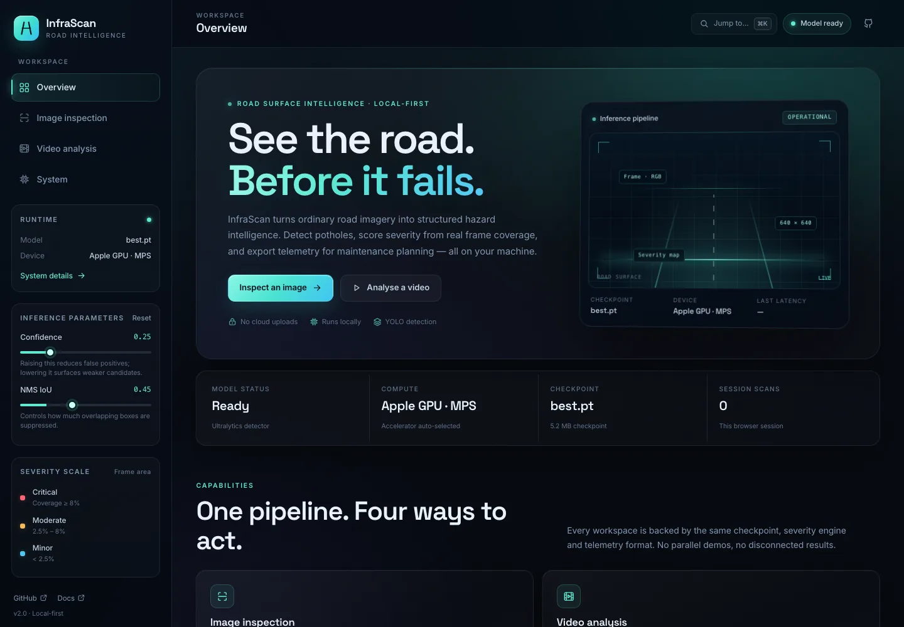
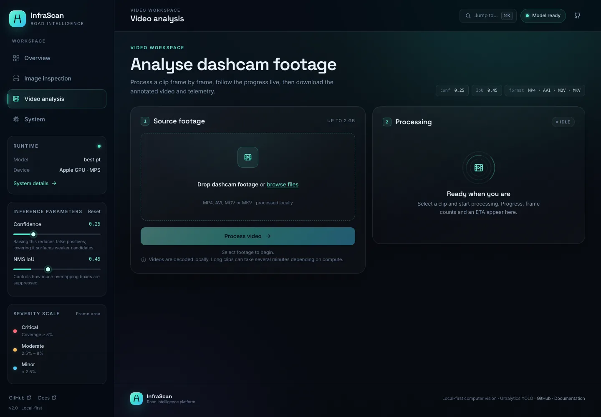
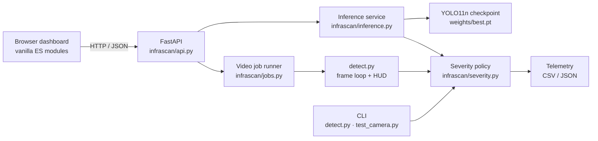

<div align="center">


# InfraScan

**Local-first road-surface intelligence for pothole inspection.**

[](https://www.python.org/)
[](https://fastapi.tiangolo.com/)
[](https://github.com/ultralytics/ultralytics)
[](LICENSE)

Inspect road images, analyse dashcam clips, score hazard severity from detected pothole area, and export structured telemetry — all on your own machine. The dashboard and CLI use the same checkpoint and the same severity policy, so a result does not change when you switch interfaces.

[Quick start](#quick-start) · [Dashboard](#dashboard) · [Benchmark](#benchmark) · [HTTP API](#http-api) · [Team](#team)

</div>

---

## Overview

InfraScan is an end-to-end computer-vision workspace for pothole inspection. It pairs an Ultralytics **YOLO11n** detector with a FastAPI backend and a zero-build browser dashboard. There is no cloud inference, no account, and no hidden demo mode: images and video are processed by the checkpoint you place in `weights/`.

| | |
| :--- | :--- |
| **Task** | Single-class pothole detection (`pothole`) |
| **Checkpoint** | YOLO11n · 2.58M parameters · 5.2 MB · 640 px input |
| **Inputs** | JPG, PNG, WebP, BMP images; MP4, AVI, MOV, MKV video; browser webcam frame |
| **Outputs** | Annotated JPEG/MP4, bounding boxes, confidence, severity, coverage %, CSV/JSON telemetry |
| **Dashboard** | FastAPI + vanilla ES modules + handcrafted CSS (no Node build step) |
| **Acceleration** | CUDA when available, then Apple MPS, then CPU |
| **License** | MIT for this repository; Ultralytics licensing applies separately |

> **Academic project, not a certified inspection instrument.** Detections and severity scores are decision support, not a substitute for a physical road survey. See [Limitations](#limitations).

---

## Interface

<p align="center">
  
</p>
<p align="center"><em>Overview — the runtime panel reports the actual checkpoint, device and session activity.</em></p>

<table>
<tr>
<td width="50%">

</td>
<td width="50%">

</td>
</tr>
<tr>
<td align="center"><em>Video analysis — upload, watch progress, download the annotated clip and telemetry.</em></td>
<td align="center"><em>System — checkpoint, runtime versions, shared severity policy and API reference.</em></td>
</tr>
</table>

The screenshots are captures of the running application on the development machine; they are not mockups.

---

## What it does

### Image inspection
- Upload a road image (up to 25 MB) or pick one of the local dataset samples when `dataset/images/test` is present.
- Capture a single frame from a browser webcam. The stream is stopped immediately after capture and never uploaded anywhere except your local server.
- Tune confidence and NMS IoU in the sidebar, then switch between the annotated and original frame.
- Read per-detection confidence, severity and bounding-box coverage, plus summary counts and maximum coverage.
- Download the detection table as CSV.

### Video analysis
- Upload a clip (up to 2 GB; MP4, AVI, MOV or MKV) and follow frame-level progress in the browser.
- The result includes an annotated MP4, CSV telemetry and JSON telemetry.
- Output prefers H.264 (`avc1`) so it plays in browsers; if the local OpenCV build cannot encode H.264, the pipeline falls back to `mp4v` and records the chosen codec in the server log.
- Video inference is serialised behind a worker lock so a long clip cannot starve the HTTP server. Jobs are tracked in memory; restarting the server clears job records, while output files remain on disk and are cleaned up on a later startup once they are older than 24 hours.

### Severity scoring
Each detection is classified from its **bounding-box area as a percentage of the frame**:

| Band | Frame coverage | Interpretation |
| :--- | :---: | :--- |
| **CRITICAL** | ≥ 8.0% | High-impact road damage; prioritise inspection |
| **MODERATE** | 2.5% – < 8.0% | Degradation requiring planned maintenance |
| **MINOR** | < 2.5% | Early surface defect with limited coverage |

The policy lives in `infrascan/severity.py` and is imported by `detect.py`, `test_camera.py` and the dashboard. It is a geometric heuristic based on the detection box, not a depth, structural or ride-quality measurement. Perspective, occlusion and box shape can change the score.

### Runtime transparency
- The system page reports the loaded checkpoint, device, Python/PyTorch/Ultralytics/OpenCV versions and the severity policy.
- Checkpoint reload is available without restarting the server.
- If the checkpoint is missing or cannot be loaded, the dashboard starts and reports the exact problem instead of substituting a model or inventing results.

### CLI parity
The original command-line workflow remains available: image and video inference, live camera HUD, dataset evaluation, training and multi-format export. CLI telemetry is written next to the prediction output as `pothole_telemetry.csv` and `pothole_telemetry.json`.

---

## Architecture



The backend loads the model once in a background thread. Image requests run in a thread pool; video jobs run in worker threads with a processing lock. The frontend is served from the same origin as the API, so there is no separate dev server, proxy or CORS configuration.

### Project layout

```text
InfraScan/
├── app.py                   # ASGI entrypoint (FastAPI)
├── run_app.py               # One-command launcher with browser opening
├── detect.py                # CLI image/video/camera inference + telemetry
├── test_camera.py           # Live OpenCV camera HUD
├── train.py                 # YOLO training pipeline
├── evaluate.py              # Test-split evaluation and plots
├── export.py                # ONNX / TensorRT / TorchScript / OpenVINO / CoreML / TFLite
├── data.yaml                # Dataset roots and class names
├── infrascan/
│   ├── api.py               # Routes, validation, static serving, security headers
│   ├── config.py            # Paths, limits, defaults
│   ├── inference.py         # Model lifecycle, device selection, annotation
│   ├── jobs.py              # Background video jobs and progress
│   └── severity.py          # Shared CRITICAL / MODERATE / MINOR policy
├── web/
│   ├── index.html           # Dashboard shell
│   └── assets/              # CSS, ES modules, local fonts, favicon
├── scripts/                 # Dataset preparation and annotation visualisation
├── docs/
│   ├── screenshots/         # README captures
│   └── evaluation/          # Verified precision-recall curve
├── requirements.txt
└── LICENSE
```

`dataset/`, `weights/` and `runs/` are deliberately excluded from version control. They are created or supplied locally.

---

## Quick start

### Requirements

- Python 3.10+ (this release was tested on Python 3.12.14)
- A compatible `best.pt` checkpoint at `weights/best.pt`, or a path supplied with `INFRASCAN_WEIGHTS`
- Optional: `dataset/` for the dataset sample picker and evaluation commands
- No Node.js or frontend build step

### Run the dashboard

```bash
git clone https://github.com/Aayush9808/InfraScan.git
cd InfraScan
python -m venv .venv
source .venv/bin/activate          # Windows: .venv\Scripts\activate
pip install -r requirements.txt

# Place a compatible checkpoint here (not bundled):
#   weights/best.pt

python run_app.py
```

Open **http://localhost:8000** for the dashboard and **http://localhost:8000/api/docs** for the interactive API reference.

Useful launcher options:

```bash
python run_app.py --host 0.0.0.0 --port 8080 --no-browser
INFRASCAN_WEIGHTS=/path/to/best.pt python run_app.py
```

> Binding to `0.0.0.0` exposes an **unauthenticated** local API to your network. Use it only on a trusted network. The default is `127.0.0.1`.

### Missing checkpoint behaviour

The dashboard still starts without a checkpoint. The model chip changes to an unavailable state, the system page explains what is missing, and detection requests return an actionable error. The dashboard never downloads a replacement checkpoint on its own. The standalone CLI scripts retain their historical fallback to Ultralytics `yolo11s.pt` when `--weights` is missing; pass an explicit checkpoint for reported results.

### Dataset sample picker

The Image inspection workspace lists up to 24 images from `dataset/images/test` when that directory exists. If it is absent, the picker is simply unavailable; upload and webcam paths continue to work.

---

## Dashboard

| Workspace | What you can do |
| :--- | :--- |
| **Overview** | See model state, compute device, checkpoint, session scans and the severity scale. |
| **Image inspection** | Upload, use a dataset sample, or capture a webcam frame; tune conf/IoU; compare annotated and original; inspect telemetry; download CSV. |
| **Video analysis** | Upload a clip, watch progress, play the annotated result, and download video/CSV/JSON. |
| **System** | Inspect checkpoint and runtime metadata, read the API and CLI reference, and reload the checkpoint. |

Keyboard and camera notes:

- `⌘K` / `Ctrl+K` opens the command palette.
- Webcam capture requires browser camera permission and a secure context (`localhost` or HTTPS). The stream stops after the frame is captured.
- Continuous live HUD testing is available through `python test_camera.py` in an OpenCV window; the browser workspace captures still frames rather than running a continuous camera inference loop.

---

## HTTP API

The dashboard and CLI are powered by the same FastAPI application. API responses are JSON except for image/video bytes and CSV downloads.

| Method | Endpoint | Purpose |
| :---: | :--- | :--- |
| `GET` | `/api/health` | Liveness probe and model state |
| `GET` | `/api/status` | Model, runtime, severity policy, limits and defaults |
| `GET` | `/api/samples` | List local test images (when the dataset is present) |
| `GET` | `/api/samples/{name}` | Serve one local sample image |
| `POST` | `/api/detect/image` | Multipart image inference (`file`, `conf`, `iou`) |
| `POST` | `/api/detect/video` | Multipart video upload; returns `202` with a job ID |
| `GET` | `/api/jobs/{id}` | Job status, progress and result URLs |
| `GET` | `/api/jobs/{id}/video` | Annotated MP4 |
| `GET` | `/api/jobs/{id}/telemetry.csv` | Frame-level telemetry CSV |
| `GET` | `/api/jobs/{id}/telemetry.json` | Frame-level telemetry JSON |
| `POST` | `/api/model/reload` | Reload the configured checkpoint |
| `GET` | `/api/docs` | Swagger UI |
| `GET` | `/api/openapi.json` | OpenAPI schema |

Example image request:

```bash
curl -X POST http://127.0.0.1:8000/api/detect/image \
  -F "file=@road.jpg" \
  -F "conf=0.25" \
  -F "iou=0.45"
```

Response shape (abridged from a real response):

```json
{
  "id": "42b4be0a01d44651931dabe615af6b52",
  "image_url": "/api/results/42b4be0a01d44651931dabe615af6b52.jpg",
  "width": 640,
  "height": 640,
  "detections": [
    {
      "id": 1,
      "confidence": 0.7519,
      "severity": "MODERATE",
      "coverage_pct": 7.0,
      "bbox": [166, 383, 407, 502]
    }
  ],
  "summary": {
    "count": 1,
    "critical": 0,
    "moderate": 1,
    "minor": 0,
    "max_coverage_pct": 7.0,
    "total_coverage_pct": 7.0
  },
  "inference_ms": 66.2,
  "conf": 0.25,
  "iou": 0.45,
  "imgsz": 640
}
```

The API has no authentication and is intended for local use. Uploads are capped at 25 MB for images and 2 GB for video; image formats are JPG, PNG, WebP and BMP, and video formats are MP4, AVI, MOV and MKV.

---

## Benchmark

A fresh evaluation was run on the full **718-image test split** with the included YOLO11n checkpoint. The split contains **994 pothole instances** and **2 background images** (empty labels).

| Metric | Result |
| :--- | ---: |
| Precision (P) | **79.59%** (`0.7959`) |
| Recall (R) | **59.96%** (`0.5996`) |
| mAP @ 0.50 | **71.11%** (`0.7111`) |
| mAP @ 0.50–0.95 | **39.38%** (`0.3938`) |
| Test images | 718 |
| Test instances | 994 |
| Preprocess / inference / postprocess | 0.17 ms / **3.82 ms** / 10.75 ms per image |

**Evaluation environment:** Apple M2, macOS (Darwin 27.0.1), Python 3.12.14, PyTorch 2.14.1, Ultralytics 8.4.183, MPS, batch 16, image size 640. The checkpoint metadata records 15 training epochs on a CUDA device; the numbers above are the MPS evaluation, not an NVIDIA benchmark. Latency will vary by hardware, batch size and image content.

<p align="center">
  
</p>
<p align="center"><em>Precision-recall curve from the 718-image run (mAP@0.50 = 0.711).</em></p>

Reproduce it after placing the checkpoint and an authorised dataset:

```bash
python evaluate.py --weights weights/best.pt --data data.yaml --split test --imgsz 640 --batch 16
```

> Earlier revisions of this README mixed a 651-image baseline table with a 718-image fine-tuned table. This version keeps only the reproducible 718-image result.

### Release checks

| Check | Verified result |
| :--- | :--- |
| Image inference | 1 MODERATE detection, 7.0% frame coverage on a test sample |
| Video pipeline | 24 frames processed, 28 frame-level detections, H.264 output played in Chrome (`readyState 4`) |
| Error handling | Invalid image → HTTP 400; offline API → actionable UI error; missing checkpoint → `unavailable` with instructions |
| Layout | Checked at 390, 820, 1024 and 1440 px; no page-level horizontal overflow |
| Camera path | Browser capture exercised with Chrome's synthetic media device; physical camera access depends on local permission |

---

## Model and dataset

### Checkpoint

| Field | Value |
| :--- | :--- |
| Architecture | Ultralytics YOLO11n (fused: 101 layers, 2,582,347 parameters, 6.4 GFLOPs) |
| Class | `pothole` (class 0) |
| Input size | 640 px |
| Checkpoint size | 5.2 MB |
| Training metadata | 15 epochs, batch 16, optimizer `auto`, initial LR 0.003, device `0` (CUDA) |
| Checkpoint SHA-256 | `f3490f953b4ac2aa0205c206c151be8f2da281da99708713b182492a43c7751c` |

The checkpoint is **not** committed. A compatible `best.pt` must be supplied locally. The training script defaults to `yolo11s.pt`, but the released checkpoint is the smaller **nano** model; use `--model yolo11n.pt` to reproduce this size.

### Dataset

The local development set is a single-class pothole dataset with **4,719 images** and **7,340 annotated pothole boxes**:

| Split | Images | Pothole instances | Background images |
| :--- | ---: | ---: | ---: |
| Train | 3,281 | 5,353 | 18 |
| Validation | 720 | 993 | 2 |
| Test | 718 | 994 | 2 |
| **Total** | **4,719** | **7,340** | **22** |

A background image is a label file with no objects; it still contributes to evaluation. Labels use normalized YOLO coordinates:

```text
<class_id> <x_center> <y_center> <width> <height>
```

The dataset and checkpoint are excluded from version control because their upstream provenance and redistribution rights have not been independently verified. Obtain them from a source you are authorised to use. `scripts/` contains dataset preparation and annotation-visualisation utilities.

---

## Training

Training requires an authorised dataset under `dataset/` and a `data.yaml` that points to it. The included checkpoint can be reproduced at nano scale with:

```bash
python train.py \
  --data data.yaml \
  --model yolo11n.pt \
  --epochs 50 \
  --batch 16 \
  --imgsz 640 \
  --device 0
```

The training pipeline enables HSV augmentation, small rotation/translation/scale jitter, mosaic, mixup and horizontal flips, with cosine learning-rate decay and early stopping. Checkpoints and plots are written under `runs/detect/`; the best checkpoint is copied to `weights/best.pt`.

| Argument | Default | Notes |
| :--- | :---: | :--- |
| `--model` | `yolo11s.pt` | Use `yolo11n.pt` for the released checkpoint size |
| `--epochs` | 50 | Training iterations |
| `--batch` | 16 | Batch size |
| `--imgsz` | 640 | Input resolution |
| `--device` | auto | `0`, `0,1`, `cpu`, etc. |
| `--patience` | 15 | Early-stopping patience |
| `--optimizer` | `auto` | `auto`, `SGD`, `Adam`, `AdamW`, `RMSProp` |

---

## CLI reference

```bash
# Image or directory inference (writes annotated outputs + telemetry)
python detect.py --source dataset/images/test --weights weights/best.pt --save

# Video inference
python detect.py --source dashcam.mp4 --weights weights/best.pt --save

# Live camera HUD (OpenCV window; Q/Esc quits, S saves a snapshot, +/- adjusts confidence, H toggles HUD)
python test_camera.py --weights weights/best.pt

# Evaluate the test split
python evaluate.py --weights weights/best.pt --data data.yaml --split test

# Export for deployment
python export.py --weights weights/best.pt --format onnx
```

`detect.py` writes to `runs/detect/predict` by default, including `pothole_telemetry.csv` and `pothole_telemetry.json`. Use `--output` to change the destination and `--no-save` to skip writing files.

### Export formats

| Format | Command | Typical target |
| :--- | :--- | :--- |
| ONNX | `python export.py --weights weights/best.pt --format onnx` | Cross-platform runtime |
| TensorRT | `python export.py --weights weights/best.pt --format engine --half` | NVIDIA edge devices |
| TorchScript | `python export.py --weights weights/best.pt --format torchscript` | C++ / LibTorch |
| OpenVINO | `python export.py --weights weights/best.pt --format openvino` | Intel CPU / iGPU |
| CoreML | `python export.py --weights weights/best.pt --format coreml` | Apple platforms |
| TFLite | `python export.py --weights weights/best.pt --format tflite` | Android / mobile |

Export is provided by Ultralytics; each target may require additional toolchains and was not exercised in this validation run. Review the target runtime's licence and hardware requirements before deployment.

---

## Team

| Name | Roll number |
| :--- | :--- |
| **Aayush Kumar Shrivastav** | 2301921540002 |
| Kajal Rawal | 2301921520087 |
| Khushi Shakya | 2301921520091 |
| Ronak Saini | 2301921520158 |

Aayush Kumar Shrivastav led the project and worked on the YOLO pipeline, backend and system architecture. This dashboard and release documentation were prepared for the team's final-year project.

---

## Attribution and licence

- **Original project and historical implementation:** Bisman Singh. The Git history and the MIT copyright notice in [`LICENSE`](LICENSE) are preserved.
- **Object-detection runtime:** [Ultralytics](https://github.com/ultralytics/ultralytics). Ultralytics YOLO is distributed under **AGPL-3.0** by default; the MIT licence of this repository does not replace Ultralytics' terms. Review the applicable licence before redistributing or deploying the model.
- **Dashboard typefaces:** Inter and Space Grotesk, bundled locally under the SIL Open Font License. Licence texts are in `web/assets/fonts/`.
- **Dataset and checkpoint:** provenance and redistribution rights have not been independently verified; both are excluded from this repository.

This repository is released under the [MIT License](LICENSE). It is an academic project and not a certified road-safety product.

---

## Limitations

- **Single class.** The model detects potholes only; it does not classify cracks, ruts, patches, manholes or other defects.
- **Heuristic severity.** Severity is based on bounding-box area relative to the frame. It is sensitive to camera distance, perspective, occlusion and box shape, and is not a structural or depth measurement.
- **No tracking.** Video results are frame-level detections. The same pothole can be counted in multiple frames; there is no cross-frame identity or deduplication.
- **No geolocation.** Telemetry contains frame/box/confidence/severity/coverage fields, not GPS coordinates or a GIS layer.
- **Local-only security model.** The API has no authentication and is intended for `127.0.0.1`. Do not expose it to an untrusted network.
- **Job state is in memory.** Restarting the server clears active/completed job records; output files remain under `runs/dashboard/` until the next startup cleanup removes entries older than 24 hours.
- **Hardware-dependent speed.** The benchmark above is an Apple M2 MPS result. First inference after startup includes warm-up; throughput on CPU or different GPUs will differ.
- **Camera permission.** Browser capture requires a secure context and explicit permission. Continuous HUD testing uses the separate OpenCV CLI.
- **Bundled assets are not included.** Without a checkpoint, detection is unavailable by design; without `dataset/`, sample images and evaluation cannot run.

---

## Documentation

- [API reference](http://localhost:8000/api/docs) (when the dashboard is running)
- [Documentation homepage](https://github.com/Aayush9808/InfraScan-Documentation#readme)
- [Project documentation repository](https://github.com/Aayush9808/InfraScan-Documentation)
- [Screenshots](docs/screenshots/) and [evaluation curve](docs/evaluation/)
- [GitHub repository](https://github.com/Aayush9808/InfraScan)

For questions or issues, open an issue on the repository with the command you ran, the checkpoint/device details from the System page, and the server log around the failure.
