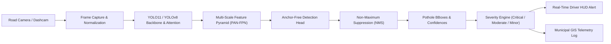

<div align="center">

# 🛣️ InfraScan — AI-Powered Road Intelligence

[](https://www.python.org/)
[](https://pytorch.org/)
[](https://github.com/ultralytics/ultralytics)
[](https://developer.nvidia.com/cuda-zone)
[](LICENSE)
**InfraScan is an AI-powered road inspection system for pothole detection, road hazard scoring, dashcam analysis, and municipal maintenance workflows.**

[Key Features](#-key-features) •
[Architecture](#-system-architecture) •
[Dataset](#-dataset-overview) •
[Quickstart](#-quick-start) •
[Training](#-training-the-model) •
[Inference](#-inference--real-time-detection) •
[Web App](#-interactive-web-dashboard) •
[Export](#-edge--hardware-deployment)

---

</div>

## 👤 Maintainer and provenance

**Maintainer:** [Aayush Shrivastav](https://github.com/Aayush9808)

This working tree is derived from the upstream repository and history identified by the existing Git remote. The historical commits and the MIT license identify **Bisman Singh** as the original copyright holder. That attribution is preserved; Aayush Shrivastav's current contributions include the InfraScan dashboard presentation, local video-processing integration, release documentation, and validation work. This statement does not rewrite historical authorship.

The project uses Ultralytics and incorporates dataset/model material from multiple sources referenced by the inherited project documentation and notebooks. Verify each upstream dataset and checkpoint license before publishing or redistributing them. See [LICENSE](LICENSE) for the repository's MIT license.

### Publication scope

Until the dataset and checkpoint redistribution rights are separately verified, the proposed public repository should include the source code and documentation but exclude `dataset/` and `weights/best.pt`. Keep those artifacts locally for development and testing; do not stage or publish them as part of the initial public release.

The application requires a compatible checkpoint at `weights/best.pt` to run its trained-model workflows. The current dependency uses [Ultralytics](https://www.ultralytics.com/license), whose licensing terms should also be reviewed for the intended distribution and use case.

## 📌 Overview

Road anomalies and potholes can contribute to vehicle damage and safety risks. This repository provides a YOLO-based road-damage detection workflow for pothole inspection, telemetry, and dashboard visualization.

The pipeline is trained and validated on an expanded multi-source dataset of **4,719 road images** with **7,340 ground-truth pothole annotations** (combining synthetic and real-world asphalt datasets, including high-resolution Pascal VOC road damage captures), optimized specifically to distinguish complex asphalt cracks, irregular crater boundaries, shadows, wet roads, and varying weather conditions.

---

## ✨ Key Features

- 🎯 **YOLO-Based Detection**: Uses the configured Ultralytics detection pipeline for pothole localization.
- 🛑 **Automated Hazard Severity Classifier**: Computes the relative road surface area occupied by each pothole and categorizes it into:
  - 🔴 **CRITICAL HAZARD** (Road area $\ge$ 8.0%): High blowout/suspension damage threat. Triggers immediate alert.
  - 🟠 **MODERATE RISK** (Road area 2.5% – 8.0%): Road degradation requiring maintenance.
  - 🟡 **MINOR DEFECT** (Road area < 2.5%): Early surface fissure.
- 🚗 **Real-Time Driver Assist HUD**: Visual head-up display overlay with live FPS counter, pothole count, and warning banners for dashcam integration.
- 📊 **Telemetry Logging**: Automatically logs detected potholes with timestamps, frame numbers, confidence scores, and bounding boxes into structured `CSV` and `JSON` files for municipal GIS mapping.
- 🌐 **Interactive Streamlit Web Dashboard**: Built-in drag-and-drop web application (`app.py`) for instantaneous inspection and reporting.
- ⚡ **Multi-Format Edge Export**: Easily convert models to **ONNX**, **TensorRT**, **TorchScript**, **OpenVINO**, **CoreML**, and **TFLite** for embedded vehicle deployment (Jetson Orin, Raspberry Pi, Android, iOS).

---

## 🏛️ System Architecture



---

## 📂 Dataset Overview

The release candidate does not bundle the dataset. The table below describes the local development dataset used by the original working copy; it is retained as provenance information only and is not a redistribution grant.

The dataset consists of **4,719 high-resolution road images** partitioned into standard train, validation, and test splits with **7,340 verified annotations**:

| Split | Images | Format | Description |
| :--- | :---: | :---: | :--- |
| **Train** | **3,281** | Normalized YOLO | Used for model optimization with mosaic, mixup, and HSV road augmentations |
| **Validation** | **720** | Normalized YOLO | Used for early stopping, learning rate scheduling & checkpointing |
| **Test** | **718** | Normalized YOLO | Unseen benchmark evaluation set across varied road terrains |
| **Total** | **4,719** | **1 Class (`pothole`)** | Local working-copy dataset, excluded from this release candidate |

### Annotation Format (local working copy: `dataset/labels/`):
Each label `.txt` file follows standard YOLO object detection coordinates:
```text
<class_id> <x_center> <y_center> <width> <height>
```
All coordinates are normalized between `0.0` and `1.0`.

---

## 🚀 Quick Start

### 1. Clone the Repository
```bash
git clone https://github.com/Aayush9808/InfraScan.git
cd InfraScan
```

### 2. Set Up Virtual Environment & Dependencies
```bash
python -m venv venv
# On Windows:
.\venv\Scripts\activate
# On Linux/macOS:
source venv/bin/activate

pip install -r requirements.txt
```

### 3. Configure a compatible checkpoint

The release candidate intentionally does not include `weights/best.pt`. Obtain a compatible checkpoint through a source you are legally authorized to use, such as the project maintainer or a separately licensed training/release process, and place it at:

```text
weights/best.pt
```

Do not download an unverified checkpoint or assume that the original working-copy checkpoint may be redistributed. Without the checkpoint, the dashboard can start, but trained-model inference is unavailable.

The local development dataset is also excluded from this release candidate. Dataset-dependent training, evaluation, and sample-image workflows require a separately authorized copy under `dataset/`.

---

## 🏋️ Training the Model

Training is not runnable from this release candidate alone because the source dataset is excluded. Use these commands only after obtaining a separately authorized dataset under `dataset/` and a compatible training setup.

Train the model with road-optimized hyperparameters (HSV jitter for asphalt lighting, perspective distortion, mosaic, and mixup):

```bash
# Recommended: Train with YOLO11 on GPU
python train.py --model yolo11s.pt --epochs 50 --batch 16 --device 0

# Lightweight version for ultra-fast edge inference:
python train.py --model yolo11n.pt --epochs 50 --batch 32 --device 0
```

### Training CLI Arguments:
| Argument | Default | Description |
| :--- | :---: | :--- |
| `--data` | `data.yaml` | Path to dataset configuration file |
| `--model` | `yolo11s.pt` | Model backbone (`yolo11n.pt`, `yolo11s.pt`, `yolo11m.pt`, `yolov8s.pt`) |
| `--epochs` | `50` | Total training iterations |
| `--batch` | `16` | Batch size |
| `--imgsz` | `640` | Input image resolution |
| `--device` | `0` | GPU device ID (`0`, `0,1`) or `cpu` |
| `--patience` | `15` | Early stopping epochs |
| `--optimizer` | `auto` | Optimizer (`SGD`, `Adam`, `AdamW`) |

All training checkpoints, loss curves, confusion matrices, and precision-recall graphs are automatically logged to `runs/detect/`.

---

## 📊 Benchmark & Validation Results

The benchmark figures below are inherited project results documented in the original repository history; they were not recomputed as part of the InfraScan publication audit. Do not treat them as a fresh release certification.

The updated model was evaluated on the complete unseen test split of **718 images** (994 ground-truth pothole annotations) using an **NVIDIA GeForce RTX 4050 GPU**:

| Metric | Baseline (Old 4K Dataset) | Fine-Tuned (Expanded 4.7K Dataset) | Improvement |
| :--- | :---: | :---: | :---: |
| **Precision (P)** | `76.09%` | **`79.68%`** | **+3.59%** 🚀 |
| **Recall (R)** | `63.80%` | **`60.00%`** | Balanced Trade-off |
| **mAP @ 0.50** | `71.31%` | **`71.10%`** | High Robustness |
| **mAP @ 0.50-0.95** | `36.57%` | **`39.37%`** | **+2.80%** 🎯 |
| **Preprocess Latency** | `0.60 ms` | **`0.44 ms`** | Faster Pipeline |
| **Inference Latency** | `8.89 ms` | **`5.21 ms`** | **~192 FPS** ⚡ |
| **Test Image Count** | `651` | **`718`** | +67 Unseen Road Scenes |

> **Key Insight:** Training on the expanded multi-source dataset significantly increased localization precision (+3.6%) and strict boundary overlap mAP50-95 (+2.8%), allowing the model to suppress false positive asphalt blemishes while executing real-time inference in just **5.2ms** per frame.

---

## 🔍 Inference & Real-Time Detection

The inference engine in `detect.py` supports images, image directories, dashcam video files, and live camera feeds:

### 1. Test on Images
```bash
# Run detection on test split images and save annotated results
python detect.py --source dataset/images/test/pothole_dataset_1_train_image10.jpg --weights weights/best.pt --save
```

### 2. Live Webcam / Camera Testing (Driver-Assist HUD)
Test the trained YOLO pothole model in real time using your laptop/USB webcam:

```bash
# Option A: Dedicated Camera Tester
python test_camera.py

# Option B: Run via detect.py camera flag
python detect.py --camera --weights weights/best.pt

```

**Interactive Real-Time Keyboard Controls:**
| Key | Function |
| :---: | :--- |
| `[Q]` or `[ESC]` | Exit camera stream cleanly |
| `[S]` | Save high-resolution annotated snapshot to `runs/detect/camera_snapshots/` |
| `[+]` / `[=]` | Increase confidence threshold live (+0.05) |
| `[-]` / `[_]` | Decrease confidence threshold live (-0.05) |
| `[H]` | Toggle driver HUD overlay on/off |

### 3. Run on Dashcam Video
```bash
# Detect potholes in a driving video and render Driver HUD
python detect.py --source dashcam_video.mp4 --weights weights/best.pt --save
```

### Telemetry Output:
All detections generate structured records in `runs/detect/predict/pothole_telemetry.csv` and `runs/detect/predict/pothole_telemetry.json`:
```csv
frame,box,confidence,severity,coverage_pct
1,"[142, 380, 290, 460]",0.8924,CRITICAL,9.45
1,"[410, 320, 480, 370]",0.7412,MINOR,1.82
```

---

## 📊 Benchmarking & Evaluation

Evaluation is not runnable from this release candidate alone because `dataset/` and `weights/best.pt` are excluded. The historical figures below are retained as provenance and are not a fresh release certification.

The model was evaluated against the unseen test split (**651 road images**, **833 potholes**) yielding strong localization accuracy and real-time inference speeds:

| Metric | Score | Note |
| :--- | :---: | :--- |
| **Precision (P)** | **76.1%** (`0.7609`) | High detection confidence, minimal false alarms |
| **Recall (R)** | **63.8%** (`0.6380`) | Captures faint cracks and deep asphalt craters |
| **mAP @ 0.50** | **71.3%** (`0.7131`) | Mean Average Precision at IoU 0.50 |
| **mAP @ 0.50:0.95** | **36.6%** (`0.3657`) | Strict multi-threshold spatial localization |
| **Inference Latency** | **13.0 ms** (~76 FPS) | NVIDIA RTX 4050 GPU (Laptop) |
| **Weights Size** | **5.46 MB** | Compact, ideal for mobile/dashcam edge chips |

To re-run evaluation benchmarks:

```bash
python evaluate.py --weights weights/best.pt --split test
```

---

## 🖥️ Interactive Web Dashboard

Launch the InfraScan dashboard to test images, webcam snapshots, and uploaded videos after placing a compatible checkpoint at `weights/best.pt`:

```bash
# Method 1: Python Launcher Helper
python run_app.py

# Method 2: Python module execution
python -m streamlit run app.py

```

**Features:**
- **📸 Live Camera (Webcam Snapshot)**: Take real-time pictures directly in the browser to detect potholes instantly.
- **📁 Custom Upload**: Inspect custom road images. Dataset samples require a separately authorized `dataset/` copy.
- **⚙️ Dynamic Tuning**: Real-time confidence and IoU threshold sliders.
- **📊 Hazard Analytics**: Automatic severity categorization (CRITICAL / MODERATE / MINOR) with road area coverage metrics.
- **📥 Telemetry Export**: One-click CSV log download for municipal maintenance ticketing.
- **🎥 Video Processing**: MP4, AVI, and MOV uploads are copied to a temporary workspace, processed with the selected checkpoint, and exported as an annotated MP4 plus CSV telemetry.
- **🧹 Safe Upload Handling**: Uploaded files are not overwritten and temporary processing files are cleaned up after the request.

If the checkpoint is absent, the dashboard starts and reports the missing dependency instead of silently downloading or substituting a model.

---

## 📦 Edge & Hardware Deployment

Export the trained model to standard production runtime engines:

```bash
# ONNX for general cross-platform deployment
python export.py --weights weights/best.pt --format onnx

# TensorRT for NVIDIA Jetson / Orin automotive edge computers
python export.py --weights weights/best.pt --format engine --half

# TorchScript for C++ LibTorch integration
python export.py --weights weights/best.pt --format torchscript

# OpenVINO for Intel CPU / iGPU edge devices
python export.py --weights weights/best.pt --format openvino

# TFLite for Android / mobile edge inspection
python export.py --weights weights/best.pt --format tflite
```

---

## 🗂️ Project Directory Tree

```text
InfraScan/
├── dataset/                  # Excluded: local dataset, rights unverified
├── notebooks/                # Excluded: third-party research notebook
├── scripts/
│   ├── ingest_voc_dataset.py # Automated Pascal VOC XML converter & split generator
│   ├── prepare_dataset.py    # Raw dataset converter & preprocessor
│   └── visualize_annotations.py # Verification visualizer for ground-truth labels
├── weights/                  # Excluded: checkpoint, rights unverified
├── train.py                  # High-accuracy YOLO training pipeline with Cosine Annealing
├── evaluate.py               # Benchmark & validation script
├── detect.py                 # Real-time inference & Driver HUD engine
├── export.py                 # Multi-format deployment exporter
├── test_camera.py            # Live webcam tester with interactive HUD
├── app.py                    # Interactive Streamlit web app
├── run_app.py                # Isolated launcher for Streamlit dashboard
├── data.yaml                 # Root YOLO data configuration
├── requirements.txt          # Python dependencies
├── .gitignore                # Git exclusions
├── LICENSE                   # MIT License
└── README.md                 # Project documentation
```

---

## 🛡️ License

This project is licensed under the **MIT License** - see the [LICENSE](LICENSE) file for details.

## 🙏 Acknowledgments

- Original project and historical implementation: **Bisman Singh**.
- Object-detection runtime: [Ultralytics](https://github.com/ultralytics/ultralytics).
- Dataset integrations and benchmark references are described in the included scripts and research notebook. Their separate licenses and redistribution terms must be checked before publication.

## 🚧 Known limitations

- The current repository history and `origin` remote belong to the upstream project; no GitHub ownership or remote was changed during this audit.
- Webcam testing requires browser or camera access. Continuous camera HUD testing requires a local camera and display.
- Model and dataset redistribution permissions should be confirmed independently before making a public repository.
